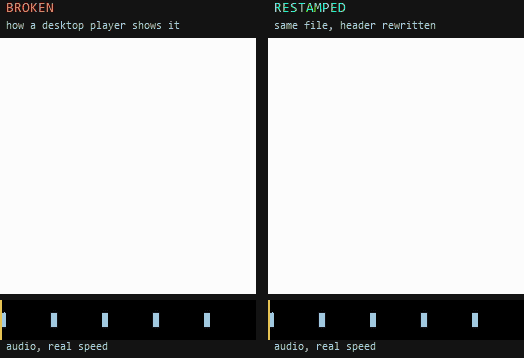

# video-restamp

Fixes MP4 videos whose timestamps are stretched, so that the footage plays in slow motion while the audio plays at normal speed. It rewrites a few tables in the file header and does not re-encode anything.



The test clip flashes white and beeps at the start of every second. The waveform under each pane is the audio, which plays at real speed in both. The broken video runs at half speed, so it flashes every 2 seconds and falls out of step with the beeps. After restamping, every flash lines up with a beep. (GIF built from `fixtures/broken-2x-h264-aac.mp4`; see [Development](#development).)

## The problem

Some videos, seen so far on TikTok (in its own player and in its downloads), carry stretched timestamps. The typical case is 60 fps footage labelled as 30 fps, with the timestamps of the audio packets stretched about 2x as well.

What you see:

- On a desktop player the footage plays in slow motion, usually at about half speed, while the audio sounds normal.
- The picture and the sound drift apart as the clip goes on.
- The same file often looks fine on a phone.

Why: a desktop player plays the audio at its real speed, because the audio decoder produces samples at a fixed rate regardless of the timestamps. It then follows the video timestamps for the picture, which are stretched, so the video lags behind. Many phone players seem to cope with the same file, but we have not looked into why. We have also not confirmed why the stretching happens on the platform side; this section describes what we have observed.

## Use it

### Web app

Everything runs in the browser tab. Files are read locally and never uploaded.

```sh
pnpm install
pnpm dev
```

Open the address Vite prints, drop in one or more `.mp4`, `.mov` or `.m4v` files, and download the fixed copy (`<name>_restamped.mp4`). Files that are already fine are reported and left alone; files that can't be fixed get a reason. A file whose audio timing looks normal but whose video is longer or shorter than the audio is marked "Check this" and only fixed if you press "Fix anyway" (see [How it works](#how-it-works)).

To build a static site that you can host anywhere:

```sh
pnpm build      # writes the site to build/
pnpm preview    # optional: serve build/ locally
```

### Command line

Needs Node 22.18 or newer (it runs the TypeScript directly) and the dependencies from `pnpm install`.

```sh
pnpm restamp [--force] in.mp4 [out.mp4]
```

It prints what it found and, if the file is broken, writes the fixed copy. Without `out.mp4` the output is `<name>_restamped.mp4` next to the input. If the file is already fine nothing is written. A `suspect` file is only written with `--force`. If it can't be handled the reason is printed and the exit code is 1.

```
$ pnpm restamp fixtures/real-world-heaac-hevc.mp4 fixed.mp4
status:   broken
length:   15.558 s real, speed factor 2.001
video:    hvc1, 934 frames, claims 31.133 s at 30.00 fps, really 60 fps (needs fix)
audio:    mp4a HE-AAC 44100 Hz, claims 31.090 s (needs fix)
wrote:    fixed.mp4
```

The "speed factor" is the length the video timestamps claim divided by the real length. 1 means fine, 2 means the footage plays twice too slowly.

### As a library

The core is `src/lib/restamp/` (TypeScript, no dependencies). `analyze(bytes)` reports, `restamp(bytes, { force })` reports and returns a fixed copy when the file is `broken`, or `suspect` and `force` is set. The status is `ok`, `broken`, `suspect` or `unsupported` (with a `reason`). Neither function throws. The contract is in `src/lib/restamp/types.ts`.

## How it works

An MP4 stores the compressed audio and video in one `mdat` box and describes it, including every sample's timestamp, in the `moov` header. Only the header is wrong in an affected file, so only the header is rewritten.

1. **The evidence comes from the audio.** An AAC packet always decodes to a fixed number of samples (1024, or 960), so its true duration is known from the AAC configuration (`esds`). That includes HE-AAC with implicit or explicit SBR, where the output rate is double the core rate but a packet still lasts the same time. If the median packet claims a duration more than 10% away from that, the audio timestamps are stretched. The median ignores a few odd packets, such as a gap or a long first packet covering encoder delay.
2. **The real length.** For stretched audio it is the packet count times the true packet duration, minus the priming that the audio edit list skips. Audio that isn't stretched is trusted as it is, gaps and all.
3. **What the video claims.** The video's length is measured the way a player shows it: from the start of its edit list to the end of the last frame, so frames hidden by a trim (`ffmpeg -ss ... -c copy`) don't count. The speed factor is that length divided by the real length.
4. **The verdict.**
   - `ok`: the audio isn't stretched and the video length is within 2% (and at least 100 ms) of the real one.
   - `broken`: the audio is stretched, and the video either already matches the real length (only the audio is fixed) or is stretched by the same factor, within 5% (both are fixed). This is the TikTok case.
   - `suspect`: the audio looks normal but the video is longer or shorter. That could be stretched video, or audio that simply doesn't cover the whole clip, and nothing in the file tells them apart. It is not fixed unless asked (`force`, "Fix anyway"), and then the video is made to match the audio.
   - `unsupported`: see [Limitations](#limitations).
5. **What gets rewritten.**
   - Video: every timestamp (each frame's decode and presentation time, and the edit's start) is multiplied by one factor, so variable frame rates keep their shape and frames stay in the same order. Constant-rate video is snapped to a whole-number rate (24, 25, 30, 48, 50, 60, 90, 100 or 120 fps) when that still ends within a frame, or 20 ms, of the audio. Otherwise the exact factor is used, so long clips at 59.94 fps don't drift. When the new durations need it, the media timescale is raised by a whole multiple: to the least common multiple with the snapped rate, so 60 fps is exactly 60 fps, or, for an exact factor, until the length is within 1 ms. Composition offsets (`ctts`, `cslg`), media duration (`mdhd`), edit list (`elst`), track duration (`tkhd`) and movie duration (`mvhd`) follow.
   - Audio: every packet gets its true duration. The last packet, usually short on purpose to trim the encoder's padding, is scaled by the same stretch and capped at a full packet. The edit list's priming is remapped.
6. **Where the new header goes.** Nothing else in the file moves, so every chunk offset (`stco`/`co64`) stays valid.
   - If the new `moov` fits where the old one was, it is written there and any slack becomes a `free` box. The file size and all offsets are unchanged. This is the usual case.
   - Otherwise, if the old `moov` is the last box, it is replaced and the file shrinks or grows.
   - Otherwise the new `moov` is appended at the end and the old one is turned into a `free` box. The file grows, and a fast-start layout (header first) is lost.
7. **Lossless.** No frame or audio sample is decoded, re-encoded or touched; the `mdat` bytes stay at the same offsets. The tests check with ffmpeg that the packets in the output are byte-identical and in the same order, that video frames keep their presentation order with all timestamps scaled by one factor, and that the video, audio and container lengths match the real length.

### Real-world example

`fixtures/real-world-heaac-hevc.mp4` is an affected TikTok file (HEVC video, HE-AAC audio) with identifying metadata blanked. Numbers from `pnpm restamp` and `ffprobe`:

| | Before | After |
| --- | --- | --- |
| Length (ffprobe, container) | 31.133 s | 15.567 s |
| Audio length | 31.090 s | 15.558 s |
| Video length | 31.133 s | 15.567 s |
| Frame rate (ffprobe) | 30 fps | 60 fps |
| Video frames | 934 | 934 |
| File size | 6,763,387 bytes | 6,763,387 bytes |

934 frames at exactly 60 fps is 15.567 s, 9 ms longer than the audio. That is within a frame, so the video is snapped to exactly 60 fps rather than the 60.03 fps the audio length implies.

## Limitations

The evidence and the real length come from the audio, so the audio has to be there and has to be AAC.

- **Video-only stretching is ambiguous.** If the audio packets are timed right but the video is longer or shorter, the file might have stretched video, or audio that genuinely doesn't cover the clip. It is reported as `suspect` and only fixed on request. A forced fix makes the video match the audio, and refuses if the implied frame rate falls outside 1 to 240 fps.
- **AAC audio only.** The file needs a video track and an AAC audio track (Main, LC, SSR, LTP, with or without SBR/PS). Files with no audio track, other audio codecs (MP3, Opus, AC-3 and so on), other AAC object types, an empty track, or more than one audio sample description are reported as unsupported.
- **One video and one audio track.** Any other enabled track (a second audio track, subtitles, timecode, metadata) would keep its old timing, so such files are unsupported. Disabled tracks are ignored.
- **Unfragmented MP4/MOV only.** Fragmented MP4 (`moof`/`mvex`), files with no `moov`, or more than one, are unsupported.
- **Edit lists.** None, or a single edit at normal speed, are handled. Multi-segment edit lists, empty edits and edits that change the rate are unsupported.
- **Stretched audio is made uniform.** Every packet of stretched audio gets the same duration, so a genuine gap inside stretched audio would be closed. Audio that isn't stretched is never changed.
- **Precision is one audio packet.** The real length is known to the nearest AAC packet (23 ms at 44.1 kHz, 46 ms for HE-AAC), plus whatever the encoder trimmed at the end. On a short clip that can't tell 59.94 fps from 60, which is why only whole-number rates are snapped to, and only when the result still ends with the audio.
- **Some files can't be corrected exactly.** If stretched audio's media timescale isn't a whole multiple of its sample rate, the audio track has composition offsets (AAC never needs them), or rescaled video timestamps no longer fit the 32-bit fields, the file is reported as unsupported rather than guessed at.
- **Whole file in memory.** The file is read into memory, and so is the output copy. Very large files are limited by the browser or Node heap.

## Development

Requires Node 22.18 or newer and pnpm 9 or newer. `ffmpeg`/`ffprobe` on PATH are optional for the tests and needed for fixtures and the demo.

```sh
pnpm install
pnpm dev        # dev server
pnpm check      # svelte-check and type checking
pnpm test       # vitest
pnpm build      # static site in build/
```

`pnpm test` runs the library and UI-text tests. The output checks (decodes without errors, packets byte-identical and in order, frame timestamps scaled by one factor, video, audio and container lengths) use ffprobe and ffmpeg when they are on PATH.

Layout:

- `src/lib/restamp/`: the library. `index.ts` is the entry, `types.ts` the contract.
- `src/routes`, `src/lib/components`, `src/lib/ui`: the web app.
- `scripts/restamp.ts`: the CLI.
- `fixtures/`: test files, named by their expected status. The synthetic ones are made by `scripts/make-fixtures.sh` (needs ffmpeg with libx264 and libx265): a test pattern that flashes white and beeps at the start of every second; broken copies made by stretching timestamps with `-itsscale` (including variable frame rate, 59.94 fps and an awkward timescale); correct but imperfect files that must be left alone (`ok-*`: trimmed, an audio gap, no edit lists, variable frame rate, 59.94 fps) or only flagged (`suspect-*`: audio shorter or longer than the video); and a file with two audio tracks (`unsupported-*`). `broken-2.5x-video-only.mp4` predates the naming and is `suspect`. `real-world-heaac-hevc.mp4` is a real affected file.
- `assets/demo/`: the README demo.

Regenerate the fixtures and the demo GIF (Git Bash, or any POSIX shell with ffmpeg):

```sh
bash scripts/make-fixtures.sh
bash scripts/make-demo.sh
```

`make-demo.sh` runs the CLI on `fixtures/broken-2x-h264-aac.mp4`, builds a waveform of the audio, and composes the two panes into `assets/demo/before-after.gif`. It looks for a monospace font on Windows, Linux and macOS; set `FONT=/path/to/font.ttf` to override.

### Stack

SvelteKit 2, Svelte 5, Vite 7, `adapter-static`, pnpm and IBM Plex Mono, the same stack as the web app of [cobalt](https://github.com/imputnet/cobalt). That is deliberate: the library is dependency-free and the UI follows the same conventions, so the core could later be proposed upstream to cobalt as a contribution without a rewrite.

## License

No license has been chosen yet. Until one is added, all rights are reserved. Note that cobalt is licensed under AGPL-3.0, which matters if the code is meant to be contributed upstream.
